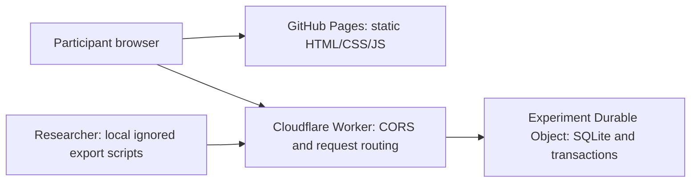

# M.I.M.O. adult concept study

A Hungarian, text-only concept norming experiment. GitHub Pages hosts the static participant interface; a Cloudflare Worker and a SQLite-backed Durable Object coordinate assignment and save responses.

- Site: https://hcccl-lab.github.io/mimo-study/
- Backend: https://mrngo-adult-api.mrngo-adult.workers.dev
- Repository: https://github.com/HCCCL-Lab/mimo-study

Open the participant link saved locally in `export/study-link.json`, rather than the bare site URL. The study name, access code, approved consent URL and consent version are created by a researcher. Participants enter a six-character Neptun code and demographics, practice, and complete exactly ten concepts from ten different categories. Each submitted text entry is saved immediately. Ten features per concept are encouraged, as in Pavlovia; they are not mandatory. Ten completed concepts are mandatory for completion status.

## Architecture



The server owns assignments and counts. One coordinator named `adult-v1` serves all named study sessions, so their response counts are shared. SQLite transactions make a concept completion, count increment, and next assignment atomic. A fixed client-generated feature ID makes retrying a save safe. Browser credentials are random bearer tokens; only token hashes are stored server-side. Neptun codes identify sessions within a named study; they do not function as passwords. Re-entering a Neptun code cannot retrieve somebody else's responses.

The 300 concepts and subcategory metadata come from the child app. The male/female baseline counts come **only** from `_examples/2026-10-19_completed_items.csv`, not from the child participants' Firebase counts. `data/concepts.json` contains this aggregate metadata and no participant records. The seed runs once, on first database initialization. Changing `SEED_MODE` later never resets live counts.

## Assignment rules

1. Exclude every category already assigned to this participant. Categories never repeat, including after refresh or midnight.
2. Exclude concepts at capacity: 21 responses, or 31 in categories `cat_02` and `cat_10`. A completed concept counts once, regardless of its number of text entries. Outstanding assignments reserve one slot so simultaneous arrivals cannot all occupy the final slot.
3. Prefer concepts whose normalized subcategory has not been used in the participant's session. If none remain in any unused category, relax only the subcategory filter.
4. Only if no under-cap candidate remains after that relaxation, permit over-cap assignment in the remaining categories. Record `overflow=1`; retain the category exclusion and subcategory preference. This guarantees all ten concepts remain possible when a category is full.
5. Select a category uniformly among eligible categories. Within it, minimize total count plus reservations. In relaxed-subcategory mode, avoid the immediately preceding subcategory if a tied candidate permits it. Then minimize the participant's gender-bin count plus reservations, and randomize remaining ties. Other/undisclosed gender uses the total-count rule and a random tie.

Reservations persist until the concept is completed or the researcher abandons the session. A browser refresh resumes the same assignment. Abandoned sessions' existing text records remain exportable but no longer reserve capacity. There is no automatic reservation expiry, to preserve resumable assignments. Researchers should release known abandoned sessions using the admin command below.

## Local development

Requires Node 22 or later.

```powershell
npm ci
Copy-Item .dev.vars.example .dev.vars
# Replace ADMIN_TOKEN with a random local secret before using the admin tools.
npm run worker:dev -- --var ALLOWED_ORIGINS:http://127.0.0.1:4173
```

In a second terminal:

```powershell
npm run dev
node scripts/bootstrap-study.mjs --local
```

Open `participantLink` from `export/local-study.json`. The local frontend uses port 4173, and the local backend uses 8787. Local and production databases are separate. The entire `export/` directory, `.dev.vars`, `.wrangler/`, `_examples/`, environment files, credentials, keys and database snapshots are ignored by Git.

```powershell
npm test
npx wrangler deploy --dry-run --outdir .wrangler/build
node scripts/runtime-qa.mjs
npm run build
```

The tests cover selection priorities, subcategory relaxation, cap exceptions, ten-category completion, consent/credential checks, restart persistence, idempotent requests, admin protection, and CORS. Runtime QA exercises actual Cloudflare SQLite Durable Objects locally, including simultaneous duplicate saves. No test participant records are sent to production by these tests.

## Deploy

`wrangler.jsonc` is pinned to the lab account `78312cea778f5326880850ebbb0ea78a`. Check `npx wrangler whoami` before a production change. To switch logins, sign into the correct Cloudflare dashboard account, then run `npx wrangler logout`, `npx wrangler login`, and `npx wrangler whoami`.

```powershell
node scripts/deploy-backend.mjs
```

This deploys the Worker, creates/reuses a long random admin credential in ignored `.dev.vars`, and uploads it as a Cloudflare secret. It updates ignored `export/config.json` with the returned backend URL. Preserve `.dev.vars` securely: it is the researcher's administrative credential. The participant bundle never receives it. The public backend URL lives in `web/config.js` and can be overridden at build time with `API_BASE_URL`.

Set the repository's **Settings → Pages → Source → GitHub Actions**. Pushing `main` runs tests, builds only `web/` into `dist/`, and deploys that directory. Neither data, exports, backend code nor `_examples` is included in the Pages artifact. The workflow does not require Cloudflare credentials. Backend changes are deployed explicitly from an authenticated lab terminal.

After Pages is available:

```powershell
node scripts/bootstrap-study.mjs
```

The initial named study's private enrollment link is written to ignored `export/study-link.json`. Subsequent runs reuse that file. Additional study names can be created through `scripts/admin.mjs`. It reads `ADMIN_TOKEN` from the project's ignored `.dev.vars` file automatically; `MRNGO_ADMIN_TOKEN` in the terminal environment overrides that value. The output directory is created automatically, and existing output files are checked before contacting the server. On Windows PowerShell, use `npm.cmd` instead of `npm` for the commands below: the PowerShell npm wrapper can strip option names. Use `--consent-version`, avoiding npm's own `--version` option. Calling `node scripts/admin.mjs` directly also works:

```powershell
npm run admin -- create-study --api https://mrngo-adult-api.mrngo-adult.workers.dev --name "Seminar Monday" --consent https://hcccl-lab.github.io/mimo-study/tajekoztato.html --consent-version adult-v1 --site https://hcccl-lab.github.io/mimo-study/ --output export/monday-study-link.json
npm run admin -- stats --api https://mrngo-adult-api.mrngo-adult.workers.dev
npm run admin -- abandon --api https://mrngo-adult-api.mrngo-adult.workers.dev --session SESSION_UUID
npm run admin -- close-study --api https://mrngo-adult-api.mrngo-adult.workers.dev --study STUDY_UUID
```

Closing a study stops new enrollment; enrolled participants can finish. Same-browser resume is supported. Losing browser storage requires researcher assistance; a Neptun code alone never grants access. Cross-device token recovery is not implemented.

## Exports and study materials

`export/download.mjs` is a deliberately **gitignored local script**. It downloads a dated exact JSON export, response CSV, participant CSV, concept counts, and a SHA-256 checksum. Run `node export/download.mjs` after data collection. Read `export/README.md` for details. The tracked admin CLI also supports `export --output export/database.json` if the local folder needs rebuilding. These are logical exports; Cloudflare's point-in-time recovery is the additional database recovery mechanism.

The response dataset includes concept/assignment IDs, ordinal, category, subcategory, cap/subcategory exceptions, assignment/completion times, and every submitted text entry's server save time. Participant exports include study, Neptun, demographics, consent version and session timestamps. Partial text responses are retained even when a concept or session is unfinished; these do not increment completed-concept counts.

`web/tajekoztato.html` preserves the supplied consent document. Before recruiting, the lab should reconcile its existing child-related wording and separate-database statement with this adult deployment: this implementation currently keeps identifiable session data and responses in separate tables in the same private database. The document was not silently rewritten. Retention/deletion scheduling is not implemented; manage the document's retention commitment through the lab's process.

The trial keeps the minimal Pavlovia presentation, with a responsive two-column workspace on desktop and a stacked workspace on phones. Elements use normal document flow so the help button, progress and response controls cannot overlap. Child-app M.I.M.O. images and help questions are reused, with a plain background and system fonts. The supplied adult directory lacks `background.png`, `favicon.png`, `help.png`, Arvo font files and the tutorial video. Practice responses stay in browser memory and do not enter research counts.
